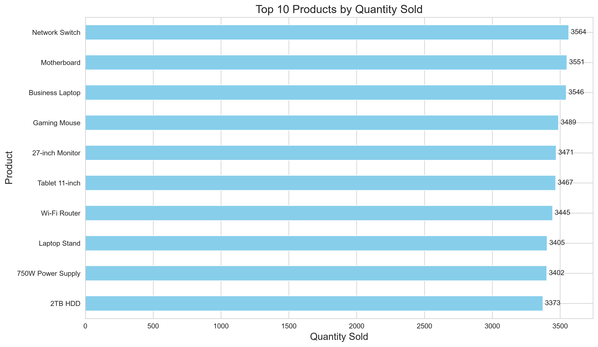
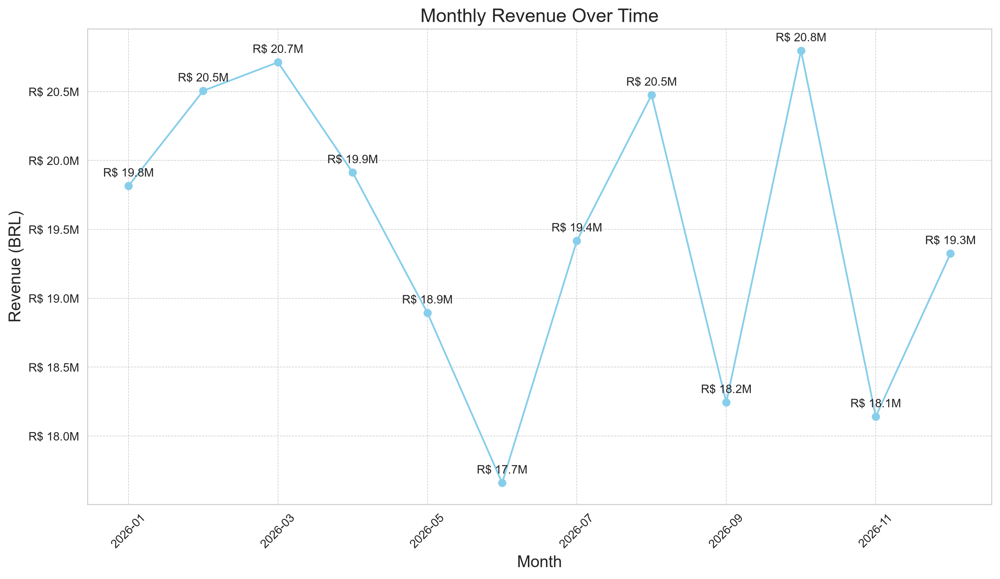
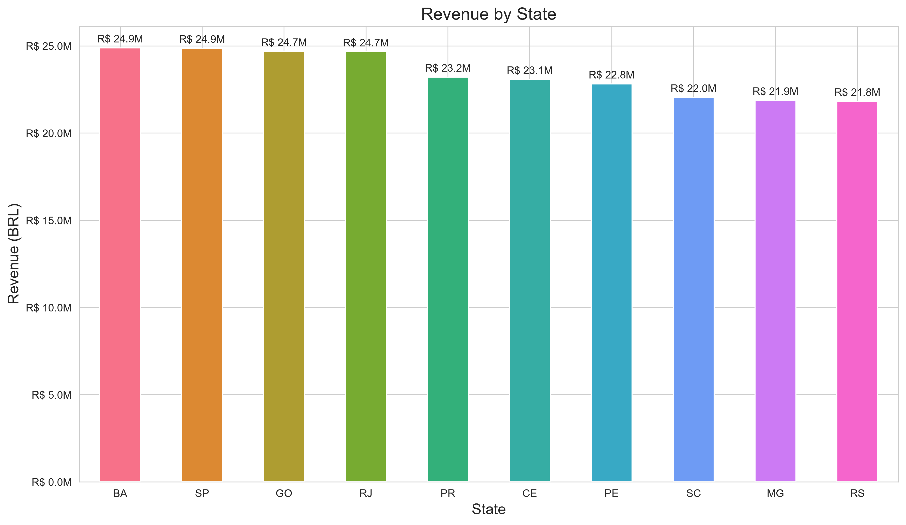
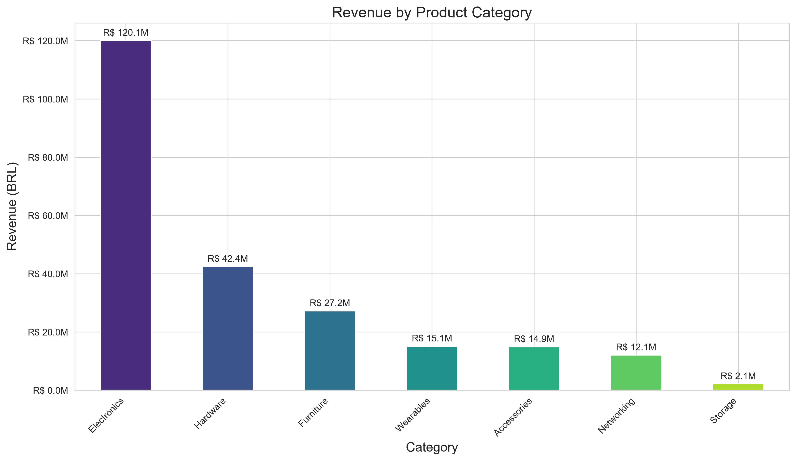

# Sales Data Analysis with Python
[English](README.md) | [Português](README.pt-BR.md)

## Overview

This project presents an end-to-end exploratory analysis of a synthetic e-commerce sales dataset using Python.

The objective is to transform transactional data into business insights related to product performance, revenue evolution, geographic distribution, and product category contribution.

The project covers the full analytical workflow, including synthetic data generation, data exploration, cleaning, feature engineering, aggregation, visualization, and interpretation of results.

> **Note:** All data used in this project was synthetically generated in Python for educational and portfolio purposes. It does not represent any real company, customer, or commercial operation.

---

## Business Problem

The e-commerce operation is growing and processing an increasing volume of daily transactions. However, raw sales data alone does not provide enough visibility to support effective business decisions.

The main challenges addressed in this project are:

- limited visibility into high- and low-performing products;
- insufficient understanding of revenue contribution by product category;
- lack of a structured view of monthly sales performance;
- limited geographic visibility to support expansion and marketing decisions.

---

## Business Questions

The analysis aims to answer four main questions:

- **What should we sell?** Identify the best-performing products and support inventory and portfolio decisions.
- **Where should we focus?** Understand which product categories generate the highest revenue.
- **When should we act?** Analyze monthly revenue performance and identify relevant variations over time.
- **Where should we expand?** Evaluate revenue distribution across Brazilian states and identify stronger markets.

---

## Dataset

The dataset contains **10,000 synthetic sales transactions** generated programmatically in Python.

It includes information such as:

- sale ID;
- transaction date;
- product;
- product category;
- unit price;
- quantity sold;
- customer ID;
- Brazilian state;
- city.

The product catalog contains **50 different products** distributed across categories such as:

- Electronics
- Hardware
- Furniture
- Accessories
- Networking
- Wearables
- Storage

All monetary values are expressed in **Brazilian Real (BRL)**.

---

## Technologies

- Python
- Pandas
- NumPy
- Matplotlib
- Seaborn
- Jupyter Notebook

---

## Analytical Workflow

1. Business problem definition
2. Library imports
3. Synthetic data generation
4. Data loading and initial exploration
5. Data cleaning and preprocessing
6. Feature engineering
7. Product performance analysis
8. Monthly revenue analysis
9. Geographic revenue analysis
10. Product category analysis
11. Business insights and conclusions

---

## Key Insights

- **Network Switch** recorded the highest sales volume with **3,564 units sold**, followed by Motherboard and Business Laptop.
- Monthly revenue remained relatively stable throughout the year, ranging from approximately **BRL 17.7 million to BRL 20.8 million**.
- **October** recorded the highest monthly revenue, while **June** presented the lowest result.
- **Bahia and São Paulo** generated the highest revenue, both reaching approximately **BRL 24.9 million**.
- **Electronics** was the leading product category, generating approximately **BRL 120.1 million**, significantly above the other categories.

Because the dataset is synthetic and randomly generated, these findings should be interpreted as analytical outputs of the simulated scenario rather than real market behavior.

---

## Visualizations

### Top 10 Best-Selling Products

The product ranking highlights the items with the highest sales volume in the synthetic dataset. Network Switch recorded the highest volume, followed closely by Motherboard and Business Laptop.



### Monthly Revenue

Monthly revenue remained relatively stable throughout the year, ranging from approximately BRL 17.7 million to BRL 20.8 million. October recorded the highest revenue, while June presented the lowest result.



### Revenue by State

Revenue was relatively evenly distributed across the analyzed Brazilian states. Bahia and São Paulo recorded the highest results, both reaching approximately BRL 24.9 million.



### Revenue by Product Category

Electronics represented the largest revenue contribution by a significant margin, generating approximately BRL 120.1 million. Hardware and Furniture ranked second and third, respectively.



---

## Project Structure

```text
sales_data_analysis_ecommerce/
│
├── images/
│   ├── top10_products_quantity_sold.png
│   ├── monthly_revenue.png
│   ├── revenue_by_state.png
│   └── revenue_by_category.png
│
├── notebooks/
│   └── sales_analysis.ipynb
│
├── .gitignore
├── README.md
└── requirements.txt

```

---

## How to Run

Clone the repository:

```bash
git clone https://github.com/Guid3Paula/sales_data_analysis_ecommerce.git
```

Navigate to the project directory:

```bash
cd sales_data_analysis_ecommerce
```

Create a virtual environment:

```bash
python -m venv .venv
```

Activate the environment on Windows:

```bash
.venv\Scripts\Activate.ps1
```

Install the required libraries:

```bash
python -m pip install -r requirements.txt
```

Open the notebook:

```text
notebooks/sales_analysis.ipynb
```

Then select the project virtual environment as the Jupyter kernel.

---

## Future Improvements

Possible future developments include:

- customer segmentation;
- profitability analysis;
- purchasing behavior analysis;
- sales forecasting;
- interactive dashboards;
- additional commercial KPIs.

---

## Conclusion

This project demonstrates how transactional data can be transformed into meaningful business information through a complete analytical workflow using Python.

Although the dataset is entirely synthetic, the project reflects a realistic business scenario and demonstrates how data analysis can support inventory management, commercial planning, geographic prioritization, and product portfolio decisions.

The workflow developed in this project includes data generation, exploration, cleaning, feature engineering, aggregation, visualization, and interpretation of business results.

---

## Disclaimer

This project was developed for educational and portfolio purposes.

The dataset is entirely synthetic and does not contain real customer, company, or commercial information.